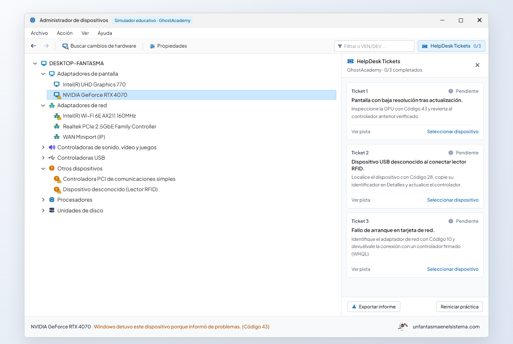
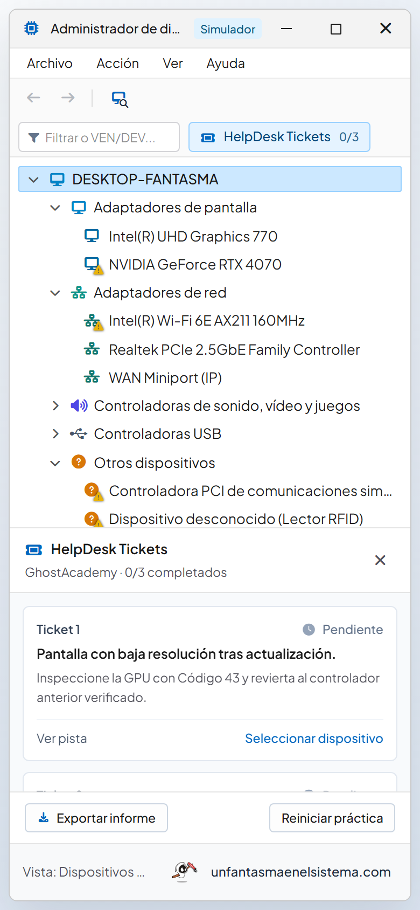

<div align="center">
  <a href="https://www.unfantasmaenelsistema.com/">
    
  </a>

  # Administrador de dispositivos — Simulador `devmgmt.msc` (Windows 11)

  **Laboratorio interactivo educativo para prácticas de soporte técnico HelpDesk, diagnóstico de controladores y auditoría de firmas digitales.**

  [](https://unfantasmaenelsistema.github.io/Administrador_dispositivos/)
  [](#estructura-del-proyecto)
  [](./LICENSE)

  **[▶ Abrir el simulador](https://unfantasmaenelsistema.github.io/Administrador_dispositivos/)** · [unfantasmaenelsistema.com](https://www.unfantasmaenelsistema.com/)
</div>

---

## Tabla de contenidos

- [Descripción general](#descripción-general)
- [Capturas reales de la aplicación](#capturas-reales-de-la-aplicación)
- [Características principales](#características-principales)
- [Solucionario rápido para docentes](#solucionario-rápido-para-docentes)
- [Estructura del proyecto](#estructura-del-proyecto)
- [Instalación y uso local](#instalación-y-uso-local)
- [Despliegue en GitHub Pages](#despliegue-en-github-pages)
- [Novedades de la versión 2](#novedades-de-la-versión-2)
- [Licencia](#licencia)

---

## Descripción general

Esta aplicación web es un **simulador educativo** (no es una herramienta de Microsoft ni toca tu equipo) que replica la interfaz y el flujo de trabajo del **Administrador de dispositivos (`devmgmt.msc`) de Windows 11**, diseñada específicamente como entorno seguro de entrenamiento para estudiantes de **GhostAcademy** y ciclos formativos de sistemas microinformáticos, redes y ciberseguridad.

Permite diagnosticar fallos reales de hardware (**Códigos 10, 28 y 43**), inspeccionar identificadores **VEN/DEV** y **VID/PID**, detectar **controladores sin firma WHQL verificada**, revisar el registro cronológico de **Eventos PnP** y resolver incidencias reales guiadas mediante el panel lateral **HelpDesk Tickets**.

---

## Capturas reales de la aplicación

> Capturas de la versión 2 tomadas sobre la compilación de producción, resolviendo los tres tickets de verdad.

### 1. Vista principal (`devmgmt.msc` + Panel HelpDesk Tickets)
Árbol de hardware dinámico con categorías expandibles, superposición de triángulos amarillos de advertencia sobre los dispositivos afectados y panel lateral de misiones.



### 2. Propiedades del dispositivo y alerta de firma digital sin verificar
Inspección de la GPU con **Código 43**, aviso visual de firma no verificada (`NVIDIA Beta Unsigned`) y botón funcional para **Revertir al controlador anterior**.


### 3. Búsqueda e instalación de controladores mediante `VEN/DEV` y `VID/PID`
Asistente de **Actualizar controlador...** donde el estudiante pega el identificador copiado desde la pestaña **Detalles** (`USB\VID_072F&PID_2200`) para localizar e instalar el paquete compatible y resolver el **Código 28**.


### 4. Resolución completa de los 3 tickets de HelpDesk
Validación automática en tiempo real al solucionar las tres incidencias asignadas (**3/3 completados**).


### 5. Versión móvil
El árbol, el filtro por VEN/DEV y el panel de tickets se apilan en pantallas estrechas.



---

## Características principales

- **Réplica visual de Windows 11 (`devmgmt.msc`)**:
  - Barra de título superior, barra de menú clásica funcional (`Archivo`, `Acción`, `Ver`, `Ayuda`), barra de herramientas con historial real (`Atrás`, `Adelante`, `Buscar cambios de hardware`, `Propiedades`) y buscador/filtro instantáneo.
  - Menú contextual con clic derecho sobre cualquier dispositivo del árbol (`Actualizar controlador`, `Deshabilitar/Habilitar`, `Desinstalar`, `Propiedades`).
- **Motor dinámico de hardware y códigos de error**:
  - **Código 43**: GPU `NVIDIA GeForce RTX 4070` con controlador beta sin verificar (`Revertir al controlador anterior` restaura la versión WHQL estable).
  - **Código 28**: Lector RFID USB sin controlador instalado (`Detalles → Identificadores de hardware` + `Actualizar controlador...` mediante `USB\VID_072F&PID_2200`).
  - **Código 10**: Adaptador `Intel(R) Wi-Fi 6E AX211 160MHz` con fallo de arranque por un controlador de prueba sin firma (`Actualizar controlador...` con `PCI\VEN_8086&DEV_51F0` o desinstalación + reescaneo PnP). Deshabilitarlo quita el aviso amarillo, pero el usuario sigue sin Wi-Fi: no resuelve el ticket.
- **Auditoría de firmas digitales (WHQL)**:
  - Valida si el `driverSigner` coincide con `Microsoft Windows Hardware Compatibility Publisher`, mostrando una alerta de seguridad cuando un driver está sin firmar o modificado.
- **Opciones avanzadas de diagnóstico**:
  - Pestaña **Eventos** con registro cronológico en tiempo real de cada acción aplicada.
  - Filtro `Ver → Mostrar dispositivos ocultos` (revela dispositivos desconectados/fantasma) y `Ver → Solo dispositivos con problemas`.
  - Guía técnica integrada en `Ayuda → Guía de códigos (10, 28, 43) y VEN/DEV`.
  - Exportación de informe técnico completo en formato `.json` (`diagnostico-devmgmt.json`).

---

## Solucionario rápido para docentes

| Ticket | Incidencia simulada | Dispositivo objetivo | Código | Solución en el simulador |
| :--- | :--- | :--- | :---: | :--- |
| **Ticket 1** | Pantalla con baja resolución tras actualización | `NVIDIA GeForce RTX 4070` | `43` | Abrir Propiedades → *Controlador* → **Revertir al controlador anterior** |
| **Ticket 2** | Dispositivo USB desconocido al conectar lector RFID | `Dispositivo desconocido (Lector RFID)` | `28` | Copiar `USB\VID_072F&PID_2200` en *Detalles* → *Controlador* → **Actualizar controlador...** |
| **Ticket 3** | Fallo de arranque en tarjeta de red | `Intel(R) Wi-Fi 6E AX211 160MHz` | `10` | Actualizar con `PCI\VEN_8086&DEV_51F0`, o desinstalar + *Buscar cambios de hardware*. Debe quedar habilitado y con firma WHQL (deshabilitarlo no cuenta) |

---

## Estructura del proyecto

```text
├── .github/workflows/
│   └── deploy-pages.yml          # Despliegue automático en GitHub Pages
├── docs/screenshots/             # Capturas reales de la aplicación
├── public/assets/logo.png        # Logo de Un Fantasma en el Sistema
├── src/
│   ├── components/
│   │   ├── ContextMenu.tsx       # Menú contextual estilo Windows 11
│   │   ├── DevicePropertiesModal.tsx  # Modal (General, Controlador, Detalles, Eventos)
│   │   ├── HelpDeskPanel.tsx     # Panel lateral de misiones GhostAcademy
│   │   ├── HelpModal.tsx         # Guía técnica de códigos y diálogo Acerca de
│   │   └── UpdateDriverModal.tsx # Buscador de software por VEN/DEV y VID/PID
│   ├── data/
│   │   └── devices.ts            # Modelo de datos JSON, tickets y lógica de árbol
│   ├── App.tsx                   # Orquestador principal de devmgmt.msc
│   ├── index.css                 # Tailwind CSS v4 (compilado en el build) y scrollbars
│   └── main.tsx                  # Punto de entrada React + FontAwesome
├── index.html
├── package.json / bun.lock       # Dependencias (Bun)
├── LICENSE                       # Apache 2.0
└── vite.config.ts                # base: './' para GitHub Pages
```

---

## Instalación y uso local

Requisitos: **[Bun](https://bun.sh/)** (el proyecto usa `bun.lock`).

```bash
git clone https://github.com/unfantasmaenelsistema/Administrador_dispositivos.git
cd Administrador_dispositivos
bun install
bun run dev        # http://localhost:3000
bun run build      # genera ./dist para publicar
bun run lint       # comprobación de tipos con TypeScript
```

---

## Despliegue en GitHub Pages

El flujo [`.github/workflows/deploy-pages.yml`](./.github/workflows/deploy-pages.yml) se ejecuta en cada `push` a `main`: instala con Bun (`bun install --frozen-lockfile`), compila `./dist` y lo publica en https://unfantasmaenelsistema.github.io/Administrador_dispositivos/ (en **Settings → Pages**, la fuente es **GitHub Actions**).

---

## Novedades de la versión 2

- **Publicado en GitHub Pages.** El workflow fallaba en segundos porque usaba `npm ci` sin `package-lock.json`, y Pages no estaba activado. Ahora compila con Bun y publica.
- **El Ticket 3 ya no se aprueba deshabilitando el Wi-Fi.** El usuario había perdido la conexión y bastaba con deshabilitar el adaptador para dar el ticket por resuelto. Ahora el adaptador tiene que quedar habilitado, funcionando y con un controlador firmado WHQL. La guía de códigos explica cuándo deshabilitar y volver a habilitar sirve y cuándo no.
- **Filtro en el móvil.** El buscador por nombre o VEN/DEV estaba oculto por debajo de 768 px.
- **Identificado como simulador educativo** en el título de la página y en la barra de la ventana.
- **Limpieza**: fuera Gemini, Express, `motion`, `lucide-react`, el plugin de copia de AI Studio, `metadata.json` y `.env.example`. El logo pasa a `public/assets/logo.png` y también es el favicon.
- **Licencia completa**: el `LICENSE` estaba recortado y GitHub no lo reconocía; ahora es el texto íntegro de Apache 2.0.

---

## Licencia

Distribuido bajo la licencia [Apache 2.0](./LICENSE).

---

<p align="center">
  Desarrollado para <a href="https://www.unfantasmaenelsistema.com/">Un Fantasma en el Sistema</a>
</p>
